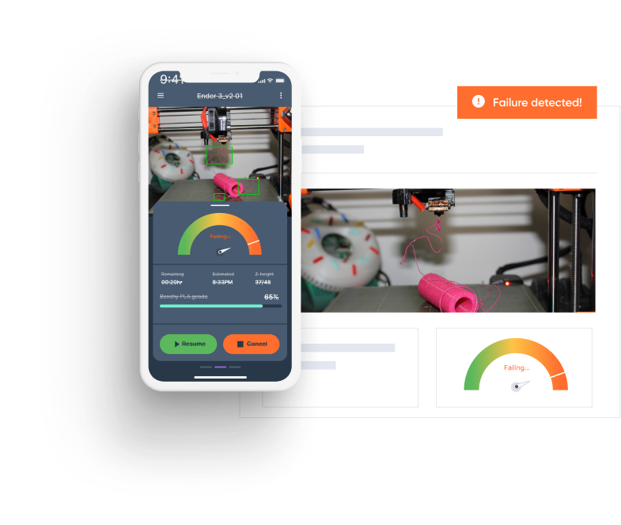

# Obico for Klipper (moonraker-obico)

**AI failure detection, remote access and webcam streaming for Klipper 3D printers.**

This Moonraker plugin connects a Klipper printer to [Obico](https://www.obico.io/klipper.html?utm_source=github&utm_medium=readme&utm_campaign=moonraker-obico). Once it's linked, Obico watches the print through your webcam, spots failures like spaghetti with AI, and pauses the print. You can also open your full Mainsail or Fluidd from anywhere.

  

## What you get

- **AI failure detection** that pauses the print or alerts you when it sees a failure.
- **Remote access** to Mainsail or Fluidd, and the Obico app for [iOS](https://apps.apple.com/us/app/the-spaghetti-detective/id1540646623) and [Android](https://play.google.com/store/apps/details?id=com.thespaghettidetective.android).
- **Webcam streaming**, including multiple cameras.
- **Print notifications** by email, Telegram, Discord, Pushover and more.
- Works on Raspberry Pi and other Linux boards, and on Creality K1 printers and the Creality Sonic Pad.

## Install

    cd ~
    git clone https://github.com/TheSpaghettiDetective/moonraker-obico.git
    cd moonraker-obico
    ./install.sh

The installer asks which Obico Server to link to. Enter the address of your [self-hosted Obico Server](https://github.com/TheSpaghettiDetective/obico-server), or press Enter to use Obico Cloud.

[Full setup guide](https://www.obico.io/docs/user-guides/klipper-setup/?utm_source=github&utm_medium=readme&utm_campaign=moonraker-obico) · [Help on Discord](https://obico.io/discord)

## Uninstall

    sudo systemctl stop moonraker-obico.service
    sudo systemctl disable moonraker-obico.service
    sudo rm /etc/systemd/system/moonraker-obico.service
    sudo systemctl daemon-reload
    sudo systemctl reset-failed
    rm -rf ~/moonraker-obico
    rm -rf ~/moonraker-obico-env

## Run it as a container

See [run_as_container.md](run_as_container.md).

## Development

    cd ~
    git clone https://github.com/TheSpaghettiDetective/moonraker-obico.git
    cd moonraker-obico
    virtualenv -p /usr/bin/python3 --system-site-packages ~/moonraker-obico-env
    source ~/moonraker-obico-env/bin/activate
    pip3 install -r requirements.txt

    # fill in essential configuration
    cp moonraker-obico.cfg.sample moonraker-obico.cfg

    # link printer (grab Obico auth token)
    python3 -m moonraker_obico.link -c moonraker-obico.cfg

    # start app
    python3 -m moonraker_obico.app -c moonraker-obico.cfg

## License

AGPL-3.0. Obico is open source; the server is at [obico-server](https://github.com/TheSpaghettiDetective/obico-server).
